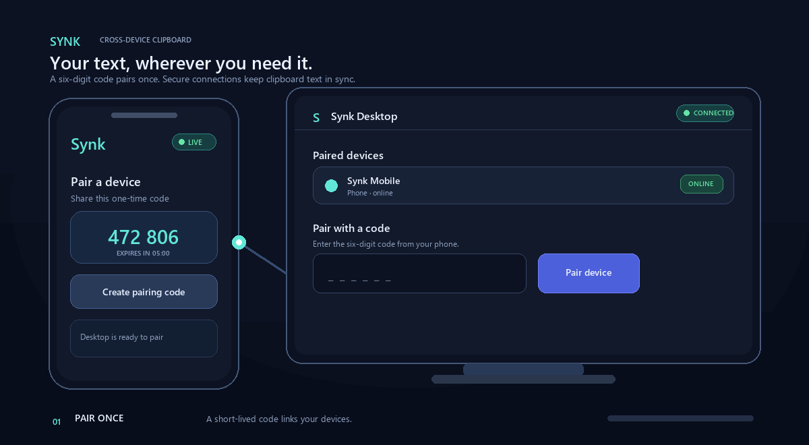
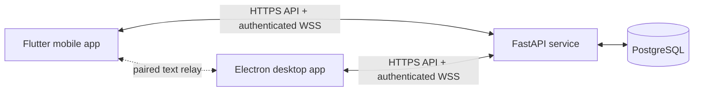

<div align="center">
  
  <h1>Synk</h1>
  <p><strong>Your text, wherever you need it.</strong><br />Pair your phone and desktop once, then keep text moving between them.</p>
  <p>
    <a href="https://github.com/shivubuilds-mikasa/synk/releases/download/v1.0.6/Synk-Setup-1.0.5.exe">Download Windows</a>
    ·
    <a href="https://github.com/shivubuilds-mikasa/synk/releases/download/v1.0.8/app-release.apk">Download Android</a>
    ·
    <a href="https://synk-api-vb4q.onrender.com/health">API health</a>
  </p>
</div>

Synk is a text-only clipboard sync app with Flutter mobile and Electron desktop clients, a FastAPI backend, and PostgreSQL storage. Pair devices with a short-
lived six-digit code; authenticated WebSocket connections relay clipboard text between paired devices.

## Try Synk

1. Install the [Windows desktop app](https://github.com/shivubuilds-mikasa/synk/releases/download/v1.0.6/Synk-Setup-1.0.5.exe).
2. Install the [Android APK](https://github.com/shivubuilds-mikasa/synk/releases/download/v1.0.8/app-release.apk).
3. Open both apps. Register the phone with a name; desktop registration happens automatically.
4. On either device, create a pairing code. Enter that code on the other device.
5. Copy text on one device and confirm it appears in Synk on the other.

The hosted test backend is on Render’s free tier. It can take up to about 50 seconds to wake after inactivity, so the first connection may be slow. Its free PostgreSQL database expires after 30 days; this deployment is for testing, not long-term storage. See [Render’s free-tier limits](https://render.com/docs/free).
The Windows installer is unsigned, so Windows may show a SmartScreen warning. The phone build now authenticates its WebSocket connection and defaults to the hosted test backend. The desktop repairs saved credentials if they belong to another backend. Existing device pairings remain in place after updating.

## What it does

- Registers mobile and desktop devices with individual credentials stored in platform secure storage.
- Pairs devices with one-time six-digit codes that expire after five minutes.
- Syncs text clipboard updates over authenticated WebSockets and supports clipboard history requests.
- Stores pairing and clipboard history data in PostgreSQL.

Synk currently syncs **text only**. It does not sync images or files and does not use account-based sign-in.

## How it fits together



## Build from source

### Requirements

- Python 3.11 or newer
- PostgreSQL 16 or newer, or Docker Compose
- Node.js and npm
- Flutter and Dart
- Java 17 or newer and the Android SDK to build the Android APK

### Backend

From the repository root, start PostgreSQL:

```powershell
docker compose up -d postgres
```

Install and run the API:

```powershell
cd backend
python -m venv .venv
.venv\Scripts\Activate.ps1
pip install -r requirements.txt
alembic upgrade head
uvicorn app.main:app --reload
```

The local health check is `http://127.0.0.1:8000/health`; interactive API docs are at `http://127.0.0.1:8000/docs`. Set `DATABASE_URL` or copy `backend/.env.example` to `backend/.env` to customize the database connection.

### Desktop

The packaged Windows app defaults to the hosted test backend. To run desktop against the local API:

```powershell
cd desktop
npm ci
$env:SYNK_BACKEND_URL = "http://127.0.0.1:8000"
npm run dev
```

Build a Windows installer with `npm run package:win`.

### Mobile

For an Android emulator, use `10.0.2.2` to reach the API running on the host computer:

```powershell
cd mobile
flutter pub get
flutter run --dart-define=API_BASE_URL=http://10.0.2.2:8000
```

To build an APK for the hosted test backend:

```powershell
flutter build apk --release --dart-define=API_BASE_URL=https://synk-api-vb4q.onrender.com
```

For a physical phone on your local network, use your development computer’s LAN address instead of `10.0.2.2`.

## Verify changes

```powershell
# Backend (from backend/); start the postgres_test service first
python -m pytest tests -q

# Desktop (from desktop/)
npm test
npm run typecheck
npm run build

# Mobile (from mobile/)
flutter analyze
flutter test
```

Backend test database setup and troubleshooting are in [backend/TESTING.md](backend/TESTING.md).

## Project map

| Path | Contents |
| --- | --- |
| `backend/` | FastAPI routes, database models, Alembic migrations, and tests |
| `desktop/` | Electron desktop client and Windows packaging |
| `mobile/` | Flutter mobile client |
| `docs/` | API, architecture, WebSocket protocol, and README animation |
| `render.yaml` | Render Blueprint for the hosted API and PostgreSQL test database |

## Further reading

- [API reference](docs/api.md)
- [Architecture](docs/architecture.md)
- [WebSocket protocol](docs/protocol.md)
- [Desktop app notes](desktop/README.md)
- [Mobile app notes](mobile/README.md)
